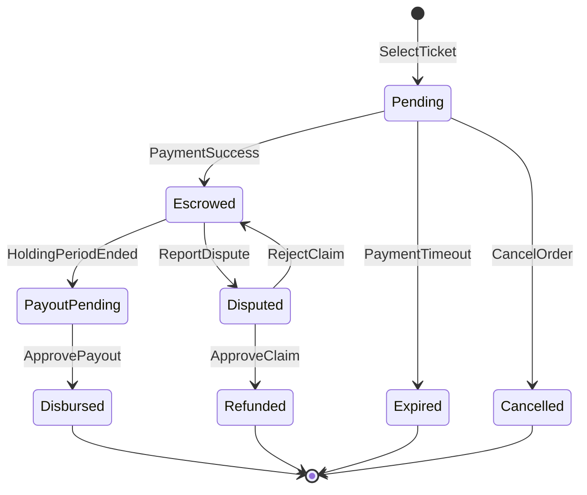
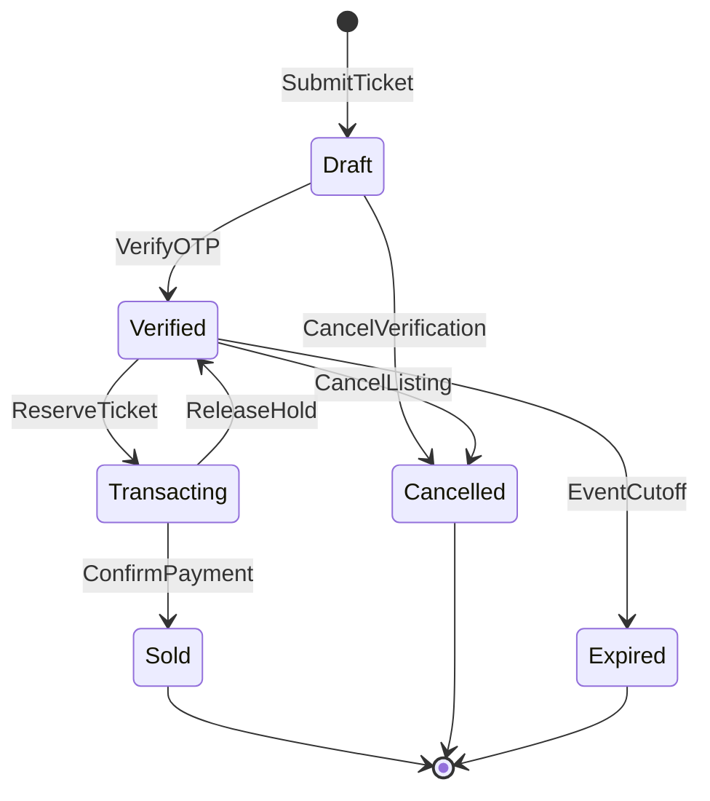

# TICKETSHIELD AI - STATE DIAGRAM & STATE MACHINE MASTERCLASS
> **Tài liệu phục vụ:** Báo cáo đồ án tốt nghiệp Capstone FA26SE261 (GVHD: Thân Thị Ngọc Vân)  
> **Chủ đề:** Biểu đồ Máy Trạng thái Chuẩn UML & Đặc tả Nghiệp vụ (UML State Machine Diagrams)  
> **Căn cứ hoàn thiện:** Biên bản góp ý Review 5 & Chuẩn thiết kế Abstract của Giảng viên hướng dẫn  
> **Tác giả:** Hoàng Thông & Đội ngũ Kỹ thuật TicketShield  

---

## 0. NGUYÊN TẮC THIẾT KẾ ABSTRACT THEO CHỈ ĐẠO CỦA GIẢNG VIÊN (REVIEW 5)

Tại buổi báo cáo tiến độ Review 5 (mốc `[27:28]`), GVHD Thân Thị Ngọc Vân đã nhấn mạnh nguyên tắc cốt lõi:
> *"Giai đoạn phân tích thiết kế chỉ mang tính trừu tượng (abstract), đừng bóc tách quá vụn ở mức code, đừng vẽ mịn quá kẻo dễ sai."*

Nhóm áp dụng triệt để mô hình **Thiết kế 2 Tầng (Two-Layer Specification)**:
1. **Tầng 1 — Trực quan hóa (Visual Diagrams):** Giữ sơ đồ cực kỳ tinh gọn, thoáng đãng, chỉ gồm **Tên State** và **Tên Event kích hoạt ngắn gọn**. Lược bỏ toàn bộ Guard condition `[...]` và Action `/ ...` chằng chịt trên mũi tên để người đọc nắm bắt ngay bức tranh tổng thể vòng đời.
2. **Tầng 2 — Thuyết minh Nghiệp vụ (Business Decision Notes & Transition Matrices):** Chuyển toàn bộ các quy tắc ràng buộc, con số cấu hình của Admin, luật bảo vệ ký quỹ, và cơ chế đối soát log vào bảng ma trận bên dưới.

Hệ thống phân định rạch ròi thành 2 State Machine độc lập theo 2 thực thể trong CSDL:
- **Thực thể Trọng tâm — `EscrowTransaction`:** Vòng đời Đơn hàng & Két ký quỹ giữ tiền an toàn (hội tụ luồng Ký quỹ Admin cấu hình, Giải ngân và Phân xử sự cố vé lỗi tại cổng).
- **Thực thể Bổ trợ — `ResaleListing`:** Vòng đời Tin đăng bán vé của người bán (xác thực OTP Gmail từ BTC, niêm yết theo trần giá và đóng sàn trước giờ diễn).

---

## 1. BIỂU ĐỒ TRẠNG THÁI TOÀN HỆ THỐNG (STATE DIAGRAM)

### 1.1. Biểu đồ Trọng tâm: Vòng đời Ký quỹ & Đơn hàng (`EscrowTransaction`)

[Toàn màn hình](./state.svg) · [Studio](../viewer.html)

  

<b>Mã nguồn Mermaid — EscrowTransaction Lifecycle</b>

---

### 1.2. Biểu đồ Bổ trợ: Vòng đời Tin đăng bán vé (`ResaleListing`)

[Toàn màn hình](./resale_listing.svg) · [Studio](../viewer.html)

  

<b>Mã nguồn Mermaid — ResaleListing Lifecycle</b>

---

## 2. BẢN GHI CHÚ QUYẾT ĐỊNH NGHIỆP VỤ & MA TRẬN CHUYỂN TRẠNG THÁI

### 2.1. Quyết định Nghiệp vụ cho `EscrowTransaction` (Căn cứ Review 5)

* **Cơ chế Két ký quỹ (`Escrowed`) `[03:02, 06:13]`:**  
  Sau khi thanh toán thành công, toàn bộ tiền của Người mua được giữ an toàn trong két ký quỹ của sàn trong một khoảng thời gian đệm do Admin cấu hình (mặc định T+24h sau khi sang tên hoặc rút ngắn khi vé quét cổng thành công).
* **Báo cáo sự cố tại cổng (`Disputed`) `[03:42]`:**  
  Nếu vé bị lỗi không quét được cổng, Người mua phải liên kết tài khoản ngân hàng trước để nhận hoàn tiền, sau đó gửi khiếu nại kèm ảnh minh chứng và mô tả chi tiết (tối thiểu 10 ký tự). Két ký quỹ lập tức bị đóng băng tự động.
* **Quy trình Phán quyết của Quản trị viên `[05:21, 07:35, 09:13]`:**  
  Admin đối soát với nhật ký quét vé từ cổng hệ thống của Ban tổ chức (Gate Access Logs):
  - **Duyệt khiếu nại (`ApproveClaim`):** Xác nhận vé lỗi/vé bị từ chối -> Kích hoạt lệnh hoàn tiền 100% từ két ký quỹ về STK người mua (`Refunded`); trừ điểm uy tín người bán (BR-D07).
  - **Bác bỏ khiếu nại (`RejectClaim`):** Log cổng chứng minh người mua đã quét vé vào xem sự kiện bình thường (khiếu nại gian lận) -> Trả giao dịch về `Escrowed`. Bộ đếm giờ tiếp tục đếm nốt phần thời gian bảo hiểm còn lại; nếu thời hạn đã kết thúc, hệ thống tự động chuyển sang `PayoutPending`.
* **Giải ngân hai bước (`PayoutPending` -> `Disbursed`) `[00:13:03]`:**  
  Khi hết thời hạn ký quỹ an toàn mà không có khiếu nại, giao dịch chuyển sang `PayoutPending` để Admin thực hiện đối soát và phê duyệt chuyển tiền về STK người bán qua cổng thanh toán NAPAS 247.

#### Ma trận Chuyển trạng thái `EscrowTransaction`

| Trạng thái Nguồn | Sự kiện (Trigger) | Điều kiện rào (Guard) | Hành vi / Tác động tài sản (Action) | Trạng thái Đích |
| :--- | :--- | :--- | :--- | :--- |
| **[*]** | `SelectTicket` | Trước giờ đóng sàn (`BeforeCutoffTime`) | Khóa giữ vé; sinh mã VietQR động; tạo bản ghi ký quỹ `Pending`. | **Pending** |
| **Pending** | `PaymentTimeout` | Quá hạn 10 phút giữ chỗ | Giải phóng vé đang giữ về lại sàn; đóng giao dịch. | **Expired** |
| **Pending** | `CancelOrder` | Người mua chủ động hủy | Giải phóng vé đang giữ về lại sàn; hủy giao dịch. | **Cancelled** |
| **Pending** | `PaymentSuccess` | Cổng thanh toán báo nhận tiền | Gọi gRPC sang tên chính chủ cho Buyer; đóng băng tiền vào két ký quỹ. | **Escrowed** |
| **Escrowed** | `HoldingPeriodEnded` | Hết thời gian ký quỹ do Admin cấu hình & Không có khiếu nại | Chạy Atomic CAS: chuyển giao dịch vào danh sách chờ giải ngân. | **PayoutPending** |
| **PayoutPending** | `ApprovePayout` | Admin phê duyệt đối soát | Kích hoạt chuyển khoản ngân hàng về STK người bán; cập nhật giải ngân thành công. | **Disbursed** |
| **Escrowed** | `ReportDispute` | Trong thời hạn ký quỹ & Người mua báo lỗi vé tại cổng | Chạy Atomic CAS: lập tức phong tỏa két ký quỹ; đình chỉ giải ngân. | **Disputed** |
| **Disputed** | `ApproveClaim` | Admin xác nhận vé lỗi từ log cổng BTC | Hoàn tiền 100% từ két ký quỹ về STK người mua; trừ điểm uy tín người bán. | **Refunded** |
| **Disputed** | `RejectClaim` | Admin xác nhận vé đã quét vào cổng thành công | Mở đóng băng quỹ; trả về `Escrowed` để tiếp tục thời gian đệm bảo vệ thông thường. | **Escrowed** |
| **Disbursed / Refunded / Expired / Cancelled** | **[*]** | Hoàn tất chu trình | Lưu vết nhật ký kiểm toán (Audit Trail); đóng vòng đời giao dịch. | **[*]** |

---

### 2.2. Quyết định Nghiệp vụ cho `ResaleListing` (Căn cứ Review 5)

* **Xác thực vé gốc chính chủ bằng OTP Gmail `[00:33]`:**  
  Khi Người bán đăng vé, hệ thống gửi mã OTP 6 số về Gmail đã đăng ký tại Ban tổ chức gốc. Chỉ khi nhập đúng OTP (`VerifyOTP`), vé gốc mới bị phong tỏa tại Ban tổ chức và tin đăng chuyển sang hiển thị công khai trên sàn (`Verified`).
* **Trần giá bán lại & Biểu phí linh hoạt `[00:56, 02:09, 05:35]`:**  
  - Giá bán không được vượt quá % trần giá cấu hình bởi Admin (`ResalePrice <= CeilingPrice`).
  - Hệ thống tự động tính biểu phí minh bạch: thu phí nền tảng 3% đối với người bán và phí chuyển đổi vé 5% đối với người mua.
  - Cho phép người bán chọn chế độ công khai (Marketplace) hoặc riêng tư (Private Link có token).
* **Đóng sàn tự động trước giờ diễn `[06:13]`:**  
  Trước giờ bắt đầu sự kiện một khoảng thời gian do Admin cấu hình (mặc định 2 tiếng), sàn tự động ngừng cho phép đặt mua (`EventCutoff`), tin đăng chuyển sang `Expired` và vé gốc được giải phóng về kho BTC.

#### Ma trận Chuyển trạng thái `ResaleListing`

| Trạng thái Nguồn | Sự kiện (Trigger) | Điều kiện rào (Guard) | Hành vi / Tác động tài sản (Action) | Trạng thái Đích |
| :--- | :--- | :--- | :--- | :--- |
| **[*]** | `SubmitTicket` | Người bán nhập mã vé lần đầu | Tạo bản ghi nháp `Draft`; phát OTP xác thực về Gmail người bán từ hệ thống BTC. | **Draft** |
| **Draft** | `VerifyOTP` | OTP hợp lệ & chưa hết hạn | Gọi gRPC khóa vé gốc tại BTC (`LOCKED_FOR_RESALE`); đưa vé lên sàn giao dịch. | **Verified** |
| **Draft** | `CancelVerification` | Quá hạn OTP hoặc Người bán hủy | Xóa bản ghi nháp; giải phóng tài nguyên. | **Cancelled** |
| **Verified** | `ReserveTicket` | Người mua bấm thanh toán | Khóa giữ vé tạm thời 10 phút để tránh bán trùng (Double Allocation). | **Transacting** |
| **Verified** | `CancelListing` | Người bán chủ động gỡ vé (chưa ai giữ chỗ) | Kiểm tra vé an toàn; gọi gRPC mở khóa vé gốc tại BTC. | **Cancelled** |
| **Verified** | `EventCutoff` | Chạm mốc đóng sàn trước giờ diễn (Admin cấu hình) | Tự động hạ tin khỏi Marketplace; gọi gRPC hoàn vé gốc về cho người bán. | **Expired** |
| **Transacting** | `ReleaseHold` | Người mua hủy hoặc quá hạn thanh toán 10 phút | Mở khóa vé; đưa vé trở lại trạng thái sẵn sàng bán trên sàn. | **Verified** |
| **Transacting** | `ConfirmPayment` | Người mua chuyển khoản thành công | Đóng tin niêm yết vĩnh viễn; xác nhận giao dịch thành công. | **Sold** |
| **Sold / Cancelled / Expired** | **[*]** | Hoàn tất chu trình | Lưu trữ dữ liệu lịch sử; đóng vòng đời tin đăng. | **[*]** |

---

## 3. BA CƠ CHẾ NGUYÊN TỬ ĐẶC BIỆT BẢO VỆ GIAO DỊCH (ATOMIC MECHANISMS)

### 3.1. Chốt chặn Nguyên tử Hai chiều (Bidirectional Atomic CAS)
- **Vấn đề thực tế:** Nếu đúng thời điểm tiền sắp giải ngân cho Người bán mà Người mua bấm nộp đơn khiếu nại (Race Condition) thì chuyện gì xảy ra?
- **Giải pháp:** Cơ chế **Compare-And-Swap (CAS)** trực tiếp tại tầng CSDL:
  - Tiến trình giải ngân: `UPDATE escrow_transactions SET status = 'Releasing' WHERE id = @id AND status = 'Locked';`
  - Người mua khiếu nại: `UPDATE escrow_transactions SET status = 'Disputed' WHERE id = @id AND status = 'Locked';`
- **Kết quả:** Vì chạy chung trong một hệ quản trị CSDL chuẩn ACID, chỉ duy nhất 1 câu lệnh thành công (Rows Affected = 1). Nếu khiếu nại xảy ra trước, tiền lập tức bị đóng băng 100%, bảo vệ an toàn tài chính tuyệt đối.

---

### 3.2. Cơ chế Bù trừ Thanh toán Muộn (Late Payment Saga Compensation)
- **Vấn đề thực tế:** Người mua chuyển khoản ở giây thứ 9 phút 59 giây, nhưng do nghẽn mạng ngân hàng, thông báo thanh toán đến server sau khi phiên giữ vé 10 phút đã hết hạn và vé đã bị người khác mua mất.
- **Giải pháp:** Áp dụng **Saga Compensation**: Hệ thống kiểm tra thấy vé đã bị giải phóng thì tuyệt đối **không cấp vé trùng**, lập tức chuyển tiền vào hàng đợi hoàn tiền tự động 100% cho người mua trả muộn.

---

### 3.3. Quy tắc Bán trọn gói Combo (Bundle Law All-or-Nothing)
- **Vấn đề thực tế:** Người bán đăng combo 2 vé liền kề (VIP Cặp đôi). Nếu người bán bấm hủy 1 vé thì xử lý thế nào?
- **Giải pháp:** Toàn bộ vé trong gói được quản lý nguyên tử theo `BundleId`. Nếu một vé bị hủy, toàn bộ các vé con trong gói đồng thời bị hủy và mở khóa về kho BTC. Triệt tiêu 100% rủi ro sinh ra vé mồ côi làm gãy cấu trúc gói vé.

---

## 4. NĂM CÂU HỎI VÀNG HỘI ĐỒNG SẼ XOÁY VÀO STATE MACHINE & CÁCH TRẢ LỜI

### Câu hỏi 1: Tại sao sơ đồ State Diagram của nhóm vẽ tinh gọn (chỉ có State và Event) mà không nhồi Guard và Action lên hình?
> **Trả lời:**  
> *"Thưa Hội đồng, đây là sự tuân thủ nghiêm ngặt **Nguyên tắc Thiết kế Trừu tượng (Abstract Modeling)** theo đúng định hướng của GVHD:  
> - Ở cấp độ mô hình hóa phân tích thiết kế, biểu đồ trực quan cần thể hiện rõ ràng và trong sáng nhất vòng đời trạng thái cốt lõi của thực thể, tránh sa đà vào các dòng code logic gây rối mắt và che lấp luồng nghiệp vụ.  
> - Toàn bộ các điều kiện rào (Guard), hành vi hệ quả (Action) và cơ chế nguyên tử bảo vệ tài sản đều được nhóm đặc tả chi tiết và chuẩn hóa trong Bảng Ma trận Chuyển trạng thái đi kèm."*

---

### Câu hỏi 2: Tại sao hệ thống tách làm 2 State Machine riêng (`EscrowTransaction` và `ResaleListing`) mà không gộp chung?
> **Trả lời:**  
> *"Thưa Hội đồng, đây là sự tuân thủ chuẩn mực **UML OMG Specification (1 Classifier = 1 State Machine)** và kiến trúc Bounded Context:  
> - `ResaleListing` quản lý vòng đời tin đăng bán vé (từ lúc xác thực OTP đến khi bán thành công hoặc hủy).  
> - `EscrowTransaction` quản lý vòng đời dòng tiền ký quỹ và phân xử đơn hàng.  
> - Một tin đăng có thể phát sinh nhiều phiên giao dịch giữ chỗ nếu người mua trước quá hạn thanh toán (quan hệ 1 - Nhiều). Việc tách bạch giúp mô hình khớp 1:1 với cấu trúc thực thể trong CSDL PostgreSQL."*

---

### Câu hỏi 3: Khoảng thời gian ký quỹ và thời hạn đóng sàn trước giờ diễn được xác định như thế nào?
> **Trả lời:**  
> *"Thưa Hội đồng, như nhóm đã báo cáo tại Review 5 (mốc `[06:13]`):  
> - Cả thời gian giữ tiền ký quỹ (mặc định 24h) và thời hạn đóng sàn trước giờ diễn sự kiện (mặc định 2 tiếng) đều được thiết kế linh hoạt thông qua bảng cấu hình hệ thống `SystemSettings` trên màn hình Admin Dashboard. Ban quản trị có thể tùy chỉnh tham số này theo đặc thù của từng quy mô sự kiện."*

---

### Câu hỏi 4: Khi người mua khiếu nại vé lỗi tại cổng, Admin đối soát dựa trên cơ sở nào để ra phán quyết hoàn tiền hay bác bỏ?
> **Trả lời:**  
> *"Thưa Hội đồng, như đã demo tại Review 5 (mốc `[05:21]` và `[07:35]`):  
> - Hệ thống không phân xử cảm tính mà tự động tích hợp API tra cứu nhật ký quét vé từ cổng soát vé của Ban tổ chức (Gate Access Logs).  
> - Nếu log cổng xác nhận vé bị lỗi hoặc chưa từng quét vào cổng, Admin duyệt hoàn tiền 100% cho người mua. Nếu log cổng chứng minh mã vé đã được quét vào cổng thành công (`VALID_ENTRY`), Admin bác bỏ khiếu nại gian lận và bảo vệ tiền cho người bán."*

---

### Câu hỏi 5: Hệ thống có cơ chế gì để chế tài người bán cố tình gian lận bán vé giả hoặc vé lỗi?
> **Trả lời:**  
> *"Thưa Hội đồng, theo giải pháp nhóm đã thống nhất tại Review 5 (mốc `[09:13]`):  
> - Hệ thống áp dụng **Cơ chế Điểm Uy tín Người bán (Reputation Score)**: Mỗi khi bị Admin xử thua trong một vụ khiếu nại, người bán bị trừ điểm uy tín nặng và ghi nhận vi phạm vào lịch sử tài khoản.  
> - Nếu điểm uy tín rơi xuống dưới ngưỡng cảnh báo, tài khoản người bán sẽ bị hệ thống tạm khóa hoặc cấm vĩnh viễn quyền đăng bán trên sàn."*
