# TICKETSHIELD AI - SYSTEM ARCHITECTURE DIAGRAM & DEFENSE MASTERCLASS
> **Tài liệu phục vụ:** Báo cáo đồ án tốt nghiệp Capstone FA26SE261 (GVHD: Thân Thị Ngọc Vân)  
> **Chủ đề:** Biểu đồ Kiến trúc Hệ thống Tổng quan (System Architecture Overview Diagram)  
> **Tác giả:** Hoàng Thông và Đội ngũ Kỹ thuật TicketShield  

---

## 1. SƠ ĐỒ KIẾN TRÚC TỔNG THỂ (SYSTEM ARCHITECTURE DIAGRAM)

[Toàn màn hình](./system.svg) · [Studio](../viewer.html)

  

> 💡 **File Mermaid độc lập:** Mã nguồn kiến trúc đã được tách riêng tại file [`system.mmd`](./system.mmd) phục vụ chỉnh sửa độc lập và nạp trực tiếp vào Studio Live Editor.

---

## 2. CHI TIẾT TỪNG PHÂN TẦNG VÀ KHỐI NGHIỆP VỤ (COMPONENT BREAKDOWN)

### 2.1. Phân tầng Người dùng và Client (Users and Client)
- **Client Application (Ứng dụng Web):** Giao diện tương tác chính cho Người mua (tìm kiếm vé, checkout, khiếu nại), Người bán (đăng bán vé, nhận tiền giải ngân) và Ban quản trị (thẩm định tranh chấp, cấu hình sàn).
- **Client Telemetry Collector:** Module chạy ngầm tại trang thanh toán thu thập các tín hiệu thời gian thao tác (timing), tần suất bấm (velocity) và dấu hiệu môi trường thiết bị để gửi qua Gateway sang dịch vụ chống bot.

---

### 2.2. Ranh giới Hệ thống TicketShield (System Boundary)
Toàn bộ phạm vi nghiệp vụ do đội ngũ TicketShield làm chủ và vận hành:

1. **Cổng Điều Phối API (API Gateway):**
   - Điểm tiếp nhận duy nhất cho mọi yêu cầu từ phía Client.
   - Chịu trách nhiệm bảo vệ an ninh biên giới (Perimeter Defense), kiểm soát CORS tập trung và phân luồng định tuyến thông minh vào các dịch vụ nghiệp vụ nội bộ.

2. **Khối Nghiệp Vụ Cốt Lõi (Core Business Services):**
   - **Dịch Vụ Xác Thực và Phân Quyền (Identity and Access Service):** Định danh tài khoản, quản lý phiên và phân quyền RBAC (Admin, Moderator, Customer).
   - **Dịch Vụ Giao Dịch và Sàn Bán Lại (Marketplace and Trading Service):** Quản lý sự kiện, tin đăng bán vé lẻ/combo, kiểm soát giữ chỗ đồng thời (CAS) và phối hợp sang tên vé chính chủ với BTC.
   - **Dịch Vụ Quản Lý Ký Quỹ và Tranh Chấp (Escrow and Dispute Service):** Lưu ký bảo vệ tiền 24h (Dual-Condition Escrow Buffer), phong tỏa khiếu nại và kích hoạt lệnh giải ngân an toàn.
   - **Dịch Vụ Quyết Toán và Giải Ngân (Settlement and Payout Service - MF-04):** Microservice chuyên trách độc lập tiền ra (Pay-out), lắng nghe sự kiện từ Event Bus, thực thi các vòng lặp Retry Worker và gọi cổng ngân hàng chuyển khoản tự động.

3. **Phân Hệ Trí Tuệ Nhân Tạo (AI Defense Subsystem - FastAPI Microservice Độc Lập):**
   - **Dịch Vụ Phát Hiện Bot & Gian Lận (AI Anti-Bot & Fraud Engine):** Tiếp nhận vector telemetry phiên mua, tính toán điểm rủi ro (Risk Scoring) qua mô hình Machine Learning và đưa ra phán quyết (Pass, Challenge, Block).
   - **Kho Dữ Liệu Dấu Vết Hành Vi (Behavioral Telemetry Store):** Lưu trữ độc lập telemetry logs và audit trail phục vụ đối soát và tái huấn luyện mô hình mà không làm chậm Core Database.

4. **Trục Tích Hợp Bất Đồng Bộ (Event Bus - RabbitMQ):**
   - Đóng vai trò cầu nối lỏng (Loose Coupling) giữa các dịch vụ, đảm bảo tính nhất quán dữ liệu cuối cùng (Eventual Consistency) và truyền tải sự kiện giải ngân sang Settlement Service.

5. **Tầng Lưu Trữ Dữ Liệu (Data Stores):**
   - **Cơ Sở Dữ Liệu Hệ Thống (Core Relational Database - `ticketshield_db`):** Quản trị tập trung giao dịch tài chính, tài khoản, vé niêm yết và hợp đồng ký quỹ tuân thủ chuẩn ACID.
   - **Cơ Sở Dữ Liệu Quyết Toán (Settlement Database - `settlement_db`):** Database độc lập của Settlement Service, theo dõi chi tiết từng đợt đối soát, mã giao dịch ngân hàng và lịch sử thanh toán tiền ra cho người bán.

---

### 2.3. Dịch Vụ Đối Tác Bên Thứ Ba (Third-Party Services)
Các hệ thống độc lập bên ngoài ranh giới của TicketShield:

1. **Hệ Thống Đối Tác (Event Organizer System / Simulator):**
   - Cung cấp giao diện dịch vụ để TicketShield xác thực mã vé gốc và thực hiện lệnh vô hiệu hóa vé cũ để phát hành mã vé mới chính chủ cho người mua.
   - Cung cấp nhật ký quét cổng vào cửa phục vụ đối soát khi có tranh chấp.

2. **Cổng Thanh Toán Trực Tuyến (Payment Gateway - Thu Tiền Vào):**
   - Tiếp nhận giao dịch chuyển khoản VietQR từ người mua và gửi Webhook thông báo kết quả thanh toán trực tiếp về Dịch vụ Giao dịch (Core).

3. **Cổng Chuyển Khoản Liên Ngân Hàng (Banking Payout Service - Chi Tiền Ra - NAPAS 247):**
   - Tiếp nhận lệnh giải ngân tự động từ Dịch vụ Quyết toán (Settlement Service) để bắn tiền trực tiếp về số tài khoản ngân hàng của người bán.

---

## 3. CÂU HỎI HỘI ĐỒNG VỀ KIẾN TRÚC VÀ CÁCH TRẢ LỜI

### Câu hỏi 1: Tại sao sơ đồ kiến trúc phải phân định rõ Ranh giới Hệ thống (System Boundary) và Dịch vụ Bên thứ ba?
> **Trả lời:**  
> *"Thưa Hội đồng, việc phân định rõ System Boundary là nguyên tắc cốt lõi của kiến trúc phần mềm:  
> 1. **Xác định rõ ranh giới trách nhiệm (Scope of Responsibility):** TicketShield chỉ làm chủ logic lưu ký, sàn giao dịch và công nghệ chống bot. Các phần việc phát hành vé gốc thuộc về Ban tổ chức, còn thanh toán thuộc về Cổng thanh toán và Ngân hàng.  
> 2. **Kiểm soát bề mặt an ninh:** Mọi tương tác đi qua biên giới hệ thống đều phải đi qua Gateway và các giao thức bảo mật chặt chẽ, loại bỏ hoàn toàn các kết nối tùy tiện giữa client ngoài Internet và dịch vụ nội bộ."*

---

### Câu hỏi 2: Vai trò của Hệ thống Phân phối Sự Kiện (Event Bus) trong kiến trúc là gì?
> **Trả lời:**  
> *"Thưa Hội đồng, Event Bus đóng vai trò là xương sống kết nối bất đồng bộ giữa các phân hệ:  
> - Khi người dùng cập nhật hồ sơ hoặc đổi số tài khoản ngân hàng, Dịch vụ Xác thực chỉ cần bắn sự kiện lên Event Bus. Dịch vụ Giao dịch tự động lắng nghe và cập nhật bản ghi mà hai dịch vụ không cần phụ thuộc trực tiếp vào nhau.  
> - Điều này đảm bảo tính độc lập (Decoupling) và giúp hệ thống có khả năng chịu lỗi cao (Fault Tolerance)."*

---

### Câu hỏi 3: Làm thế nào hệ thống đảm bảo người mua nhận được vé hợp lệ từ Ban tổ chức mà không bị lừa vé giả?
> **Trả lời:**  
> *"Thưa Hội đồng, hệ thống tích hợp trực tiếp 2 chiều với Hệ Thống Đối Tác (Event Organizer System):  
> - Trước khi niêm yết: Mã vé được gửi sang đối tác để xác minh tình trạng vé và phong tỏa vé gốc.  
> - Khi người mua thanh toán: Hệ thống gửi yêu cầu sang tên chính chủ, hủy mã vé cũ của người bán và sinh mã QR mới tinh chính chủ gửi thẳng vào tài khoản người mua. Người mua hoàn toàn không nhận ảnh chụp màn hình hay mã vé cũ từ tay người bán."*

---

### Câu hỏi 4: Cơ chế Ký quỹ bảo vệ quyền lợi người mua và người bán như thế nào?
> **Trả lời:**  
> *"Thưa Hội đồng, Dịch vụ Ký quỹ (Escrow Service) giữ vai trò trọng tài tài chính trung gian:  
> - Tiền thanh toán của người mua được khóa an toàn trong két ký quỹ trong thời gian đệm bảo đảm (24 giờ sau khi sang tên hoặc cho đến khi vé được quét thành công tại cổng soát vé).  
> - Nếu vé phát sinh lỗi tại cổng, người mua nộp khiếu nại, tiền được đóng băng lập tức để đối soát và hoàn 100%. Nếu không có khiếu nại, hệ thống tự động kích hoạt lệnh chuyển tiền qua Dịch vụ Chuyển khoản Ngân hàng cho người bán."*
