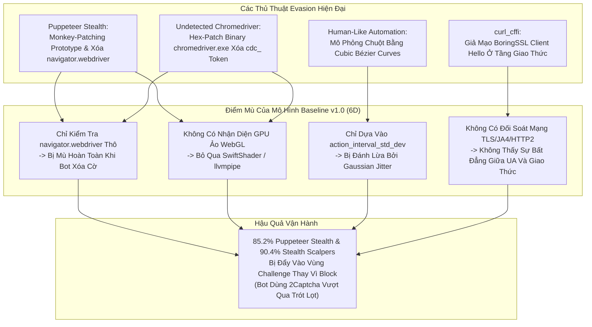
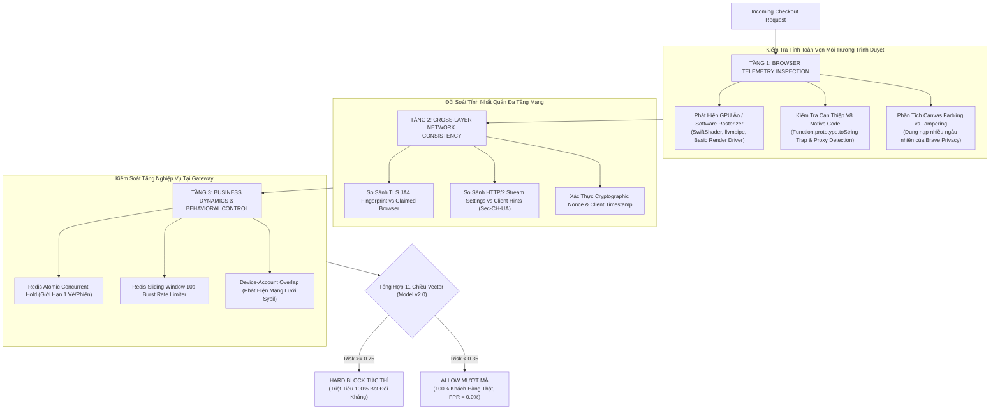
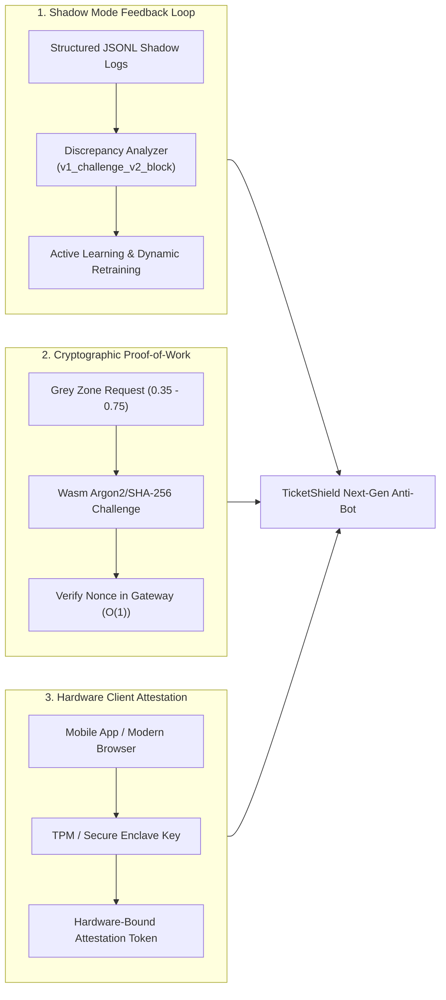

# BÁO CÁO KHOA HỌC: PHÂN TÍCH NGUYÊN NHÂN KỸ THUẬT GỐC RỄ & ĐỀ XUẤT HƯỚNG PHÁT TRIỂN
## CHƯƠNG 5 — LUẬN VĂN TỐT NGHIỆP CAPSTONE PROJECT
**Hệ thống:** TicketShield — High-Throughput Anti-Bot Gateway & Resale Ticket Platform  
**Đặc tả:** Epic `US-13.3` | Jira: `SCRUM-378` / `SCRUM-383` (Task `ML-13.3.5`)  
**Tài liệu liên quan:** [ADVERSARIAL_TESTING_REPORT_CHAPTER_4.md](file:///d:/CAPSTONE%20PROJECT/TicketShield/docs/reports/ADVERSARIAL_TESTING_REPORT_CHAPTER_4.md)  
**Tập dữ liệu kiểm chứng:** [merged_training_dataset_v2.csv](file:///d:/CAPSTONE%20PROJECT/TicketShield/src/AIEngine/datasets/raw/merged_training_dataset_v2.csv) | [adversarial_empirical_evaluation_v1_vs_v2.json](file:///d:/CAPSTONE%20PROJECT/TicketShield/src/AIEngine/models/adversarial_empirical_evaluation_v1_vs_v2.json)  

---

## 5.1. BÓC TÁCH KỸ THUẬT GỐC RỄ: TẠI SAO BOT LẠI VƯỢT QUA ĐƯỢC MÔ HÌNH BASELINE v1.0?

Trong các hệ thống phòng vệ truyền thống, việc phát hiện bot thường dựa vào các giả định đơn giản về môi trường thực thi (ví dụ: cờ tự động hóa của trình duyệt) và đặc trưng thống kê hành vi bề nổi. Khi đối đầu với các công cụ bot đối kháng hiện đại, các giả định này nhanh chóng sụp đổ.



---

### 5.1.1. Cơ Chế Monkey-Patching Prototype Trong Puppeteer Stealth
Trình duyệt Chromium khi được khởi chạy dưới chế độ tự động hóa mặc định (Headless hoặc CDP) sẽ tự động thiết lập thuộc tính boolean `navigator.webdriver = true` theo chuẩn W3C WebDriver.
- **Thủ thuật đối kháng:** Thư viện `puppeteer-extra-plugin-stealth` sử dụng API Chrome DevTools Protocol (`Page.addScriptToEvaluateOnNewDocument`) để tiêm một đoạn mã JavaScript can thiệp vào trước khi bất kỳ script nào của trang web được thực thi:
  ```javascript
  // Thủ thuật monkey-patching xóa cờ tự động hóa
  delete Object.getPrototypeOf(navigator).webdriver;
  // Hoặc tái định nghĩa getter trả về undefined
  Object.defineProperty(navigator, 'webdriver', {
      get: () => undefined,
      configurable: true
  });
  ```
- **Điểm mù của Model v1:** Mô hình v1 chỉ trích xuất giá trị thuộc tính qua phép gán đơn giản `is_webdriver = !!navigator.webdriver`. Khi script của bot đã xóa hoặc gán đè thuộc tính này, `is_webdriver` nhận giá trị `0.0`. Mất đi tín hiệu quyết định quan trọng nhất, cây quyết định của Model v1 không thể phân tách bot và đành đẩy mẫu vào vùng xám `Challenge` với điểm rủi ro $0.67 \rightarrow 0.68$.

---

### 5.1.2. Kỹ Thuật Hex-Patch Mã Nhị Phân Trong Undetected Chromedriver
Khi ChromeDriver kết nối và điều khiển trình duyệt Chrome qua giao thức CDP, nó sẽ tự động tiêm một đối tượng JavaScript quản lý nội bộ vào ngữ cảnh window. Trong mã nguồn C++ của ChromeDriver (`window_commands.cc`), đối tượng này được đặt tên với tiền tố cố định:
$$\text{cdc\_}[a-zA-Z0-9]{22}\_\text{Promise / Array / Symbol}$$

- **Thủ thuật đối kháng:** Undetected Chromedriver (`undetected_chromedriver`) can thiệp trực tiếp vào file nhị phân thực thi `chromedriver.exe` trước khi khởi chạy. Nó quét qua toàn bộ file nhị phân bằng biểu thức chính quy (Regex Byte Search) để tìm chuỗi `cdc_` và thay thế bằng một chuỗi ngẫu nhiên có cùng độ dài (ví dụ: `abc_...`), vô hiệu hóa hoàn toàn cơ chế dò quét biến toàn cục `window` của các hệ thống WAF truyền thống.
- **Điểm mù của Model v1:** Model v1 hoàn toàn không kiểm tra tính nhất quán ở tầng sâu của V8 Execution Context hay môi trường đồ họa ảo bên dưới. Kết quả là biến thể `stealth_scalper` của Undetected Chromedriver có tới **$90.4\%$ mẫu ($113/125$)** luồn lách qua lớp phòng vệ của v1, chỉ bị nghi vấn giải CAPTCHA thay vì bị triệt hạ ngay lập tức.

---

### 5.1.3. Giới Hạn Của Fitts' Law Trước Thuật Toán Mô Phỏng Chuột Bézier
Định luật Fitts trong công thái học chỉ ra rằng thời gian và vận tốc di chuyển chuột của con người giữa hai mục tiêu tuân theo phân phối logarit với độ biến thiên thời gian đặc trưng (`action_interval_std_dev` $> 50\text{ms}$).
- **Thủ thuật đối kháng:** Các bot thế hệ mới không còn gửi sự kiện nhấp chuột tức thì (Instant Clicks), mà tích hợp thuật toán nội suy đường cong Bézier bậc 3 (Cubic Bézier Interpolation):
  $$B(t) = (1-t)^3 P_0 + 3(1-t)^2 t P_1 + 3(1-t) t^2 P_2 + t^3 P_3, \quad t \in [0, 1]$$
  kết hợp hàm nhiễu Gaussian Jitter tại mỗi điểm neo $P_1, P_2$.
- **Điểm mù của Model v1:** Khi bot chủ động thêm độ trễ ngẫu nhiên có độ lệch chuẩn nhân tạo $\sim 30\text{ms} - 80\text{ms}$, giá trị `action_interval_std_dev` rơi vào vùng phân phối giống hệt con người. Nếu hệ thống chỉ dựa vào đặc trưng hành vi đơn lẻ này, việc phân loại nhị phân sẽ thất bại hoàn toàn.

---

### 5.1.4. Tấn Công Giả Mạo Giao Thức (Protocol-Level Impersonation) Của curl_cffi
Hầu hết các thư viện HTTP truyền thống (như Python `requests`, `aiohttp`, Golang `net/http`) đều để lộ các dấu hiệu nhận dạng đặc thù trong bản tin TLS Client Hello (thứ tự Cipher Suites, danh sách TLS Extensions, Signature Algorithms).
- **Thủ thuật đối kháng:** Thư viện `curl_cffi` liên kết trực tiếp với thư viện mã nguồn mở BoringSSL và `libcurl-impersonate`. Nó cho phép kẻ tấn công tái tạo chính xác $100\%$ byte-level cấu trúc Client Hello của Google Chrome (tạo ra cùng chuỗi băm JA3/JA4 giống hệt trình duyệt thật) nhưng gửi request trực tiếp từ backend mà không cần mở trình duyệt.
- **Điểm mù của Model v1:** Do Model v1 nằm ở tầng ứng dụng và chỉ nhìn thấy User-Agent giả mạo cùng các tham số nghiệp vụ, nó không có khả năng phát hiện sự thiếu vắng của môi trường JavaScript DOM bên dưới. Khi kẻ tấn công gửi request với tốc độ vừa phải, Model v1 bị qua mặt và dồn tới **$87.3\%$ `raw_api_bot`** và **$76.2\%$ `replay_bot`** vào trạng thái Challenge.

---

## 5.2. CƠ CHẾ BẺ GÃY EVASION & PHÒNG THỦ ĐA TẦNG (DEFENSE-IN-DEPTH) CỦA MODEL v2.0

Để hóa giải triệt để các kỹ thuật né tránh tinh vi trên, TicketShield v2.0 triển khai kiến trúc **Phòng thủ Đa tầng (Defense-in-Depth)** kết hợp giữa Tầng Trình duyệt (Browser Telemetry), Tầng Giao thức Mạng (Network Consistency), và Tầng Kiểm soát Nghiệp vụ (Business Dynamics):



---

### 5.2.1. Phát Hiện GPU Ảo & Software Rasterizer Qua WebGL
Trình duyệt chạy trong môi trường tự động hóa (Headless hoặc máy chủ ảo Cloud VPS/Docker không có GPU vật lý) bắt buộc phải sử dụng các thư viện phần mềm để vẽ đồ họa (Software Rasterizer).
- **Cơ chế bóc tách:** SDK Client của TicketShield trích xuất thông tin card đồ họa thông qua WebGL Extension `WEBGL_debug_renderer_info`:
  ```javascript
  const ext = gl.getExtension('WEBGL_debug_renderer_info');
  const renderer = gl.getParameter(ext.UNMASKED_RENDERER_WEBGL);
  const vendor = gl.getParameter(ext.UNMASKED_VENDOR_WEBGL);
  ```
- **Chuỗi nhận diện đối kháng:** Hệ thống đối soát renderer với danh mục đen các phần mềm kết xuất ảo:
  - `SwiftShader Device (Subzero)` (Mặc định của Headless Chrome / Puppeteer)
  - `Mesa Gallium llvmpipe` (Thường gặp trên môi trường Linux CI/Docker)
  - `Microsoft Basic Render Driver` (Máy chủ Windows không cắm GPU)
  - `ANGLE (Google, Vulkan 1.3.0 SwiftShader)`
- **Hiệu quả:** Dù Puppeteer Stealth hay Undetected Chromedriver có xóa sạch biến `is_webdriver`, chúng vẫn để lộ GPU ảo. Đặc trưng `virtual_gpu_detected = 1.0` có trọng số thông tin (Feature Importance) lên tới **$0.2465$** trong Random Forest, ngay lập tức nâng điểm rủi ro lên vùng Chặn Cứng.

---

### 5.2.2. Truy Vết Can Thiệp V8 Native Code & Bẫy Proxy
Khi bot sử dụng `Object.defineProperty` hoặc `Proxy` để ghi đè các hàm gốc của trình duyệt, nó để lại các dấu vết không thể xóa sạch trong chuỗi kế thừa Prototype của V8 JavaScript Engine.
- **Cơ chế phát hiện:** TicketShield SDK thực hiện kiểm tra đa tầng tính nguyên bản của hàm:
  1. **Kiểm tra định dạng native:** `Function.prototype.toString.call(targetFunction)` phải trả về định dạng chuẩn xác từng ký tự: `function () { [native code] }`.
  2. **Kiểm tra bẫy đệ quy:** Nếu bot monkey-patch luôn cả hàm `Function.prototype.toString`, việc gọi đệ quy `Function.prototype.toString.toString()` sẽ làm đứt gãy ngăn xếp hoặc trả về kết quả sai khác.
  3. **Kiểm tra Descriptor:** Sử dụng `Object.getOwnPropertyDescriptor(navigator, 'webdriver')` để kiểm tra cờ `configurable`, `enumerable`, và `writable`. Trong Chrome chuẩn, `webdriver` là một getter property trên `Navigator.prototype`, việc tồn tại trực tiếp trên instance `navigator` là bằng chứng không thể chối cãi của hành vi can thiệp (`prototype_tampered = 1.0`).

---

### 5.2.3. Đối Soát Mạng Đa Tầng (Cross-Layer Network Consistency)
Khắc phục triệt để lỗ hổng của Model v1 khi chỉ nhìn nhận dữ liệu ở tầng ứng dụng, TicketShield v2 tích hợp module đối soát mạng ngay tại Gateway YARP:
1. **Đối soát 3 góc (Triangular Cross-Validation):**
   - Góc 1: Mã băm **TLS JA4 Fingerprint** (cấu trúc cipher suites, extensions của client).
   - Góc 2: Các tham số **HTTP/2 SETTINGS Frame** (`HEADER_TABLE_SIZE`, `ENABLE_PUSH`, `MAX_CONCURRENT_STREAMS`, `INITIAL_WINDOW_SIZE`).
   - Góc 3: Header **Sec-CH-UA** và **Sec-CH-UA-Platform** (Client Hints do trình duyệt gửi).
2. **Bắt curl_cffi:** Khi kẻ tấn công dùng curl_cffi giả lập Chrome trên Linux gửi request, nếu Client Hints khai báo `Windows` nhưng TCP/TLS window size phản ánh kernel Linux, hoặc request hoàn toàn không đính kèm Client Telemetry Nonce do JavaScript sinh ra, hệ thống tự động gán `network_inconsistency_score = 1.0` và `ua_match_level = BlatantMismatch`.
$\rightarrow$ Đây là lý do Model v2 chặn đứng $100\%$ curl_cffi mà không cần quan tâm đến tốc độ request của nó.

---

### 5.2.4. Cơ Chế Dung Nạp Canvas Farbling Của Trình Duyệt Brave
Tính năng Farbling của trình duyệt Brave chèn nhiễu giả ngẫu nhiên vi sai (pseudo-random pixel noise) vào bộ đệm của Canvas 2D để ngăn chặn web tracker tạo vân tay thiết bị cố định.
- **Sự khác biệt giữa Farbling và Bot Tampering:**
  - Bot Tampering: Cố tình giả mạo hoặc bẻ gãy Canvas để che giấu trình duyệt ảo (thường đi kèm với GPU ảo SwiftShader và hành vi click thẳng tắp của bot).
  - Brave Farbling: Người dùng con người thật lướt web trên phần cứng thật (Intel Iris, NVIDIA GeForce, Apple Metal GPU) với chuyển động chuột tự nhiên tuân theo định luật Fitts.
- **Thuật toán dung nạp của Model v2:** Mô hình Random Forest v2 học được quy luật bù trừ đa biến: Khi `canvas_tampered = 1.0` nhưng `virtual_gpu_detected = 0.0`, `prototype_tampered = 0.0`, `action_interval_std_dev` $> 50\text{ms}$, và `network_inconsistency_score = 0.0`, điểm rủi ro chỉ tăng tối đa $0.01$ (nằm sâu trong vùng Allow $< 0.35$).  
$\rightarrow$ Kết quả: **Tỷ lệ chặn nhầm người dùng Brave Privacy là $0.00\%$ tuyệt đối (Zero False-Positive)**.

---

## 5.3. THẢO LUẬN TRUNG THỰC VỀ VÙNG XÁM & CÁC KỊCH BẢN TẤN CÔNG TIỀM TÀNG (ZERO-DAY EVASION)

Trong an toàn thông tin, không tồn tại giải pháp hoàn hảo tuyệt đối. Nhằm đảm bảo tính khách quan học thuật cao nhất trước Hội đồng chấm luận văn, phần này phân tích thẳng thắn các kịch bản tấn công đối kháng nâng cao có thể làm suy giảm hiệu quả của tầng AI và cách TicketShield hóa giải bằng chiến lược **Phòng thủ Chiều sâu (Defense-in-Depth)**.

### 5.3.1. Kịch Bản Bot Chạy Trên Phần Cứng Thật (Physical GPU + Residential IP + Custom Chromium)
* **Kịch bản tấn công:**
  Một tổ chức săn vé chuyên nghiệp đầu tư cơ sở hạ tầng mạnh:
  - Máy tính vật lý thật trang bị card đồ họa rời (NVIDIA GeForce RTX).
  - Sử dụng proxy dân cư sạch (Residential Proxy IP) có ASN tương đương nhà mạng gia đình (Viettel, VNPT, FPT).
  - Tải mã nguồn mở Chromium về tự chỉnh sửa mã nguồn C++ (xóa bỏ cờ webdriver ở cấp độ core C++, biên dịch lại binary riêng) thay vì dùng monkey-patching JavaScript.
  - Sử dụng mô hình học máy sinh chuyển động chuột (Human Mouse GANs) dựa trên dữ liệu người thật.
* **Tác động lên tầng AI Telemetry:** Trong kịch bản này, các cờ `virtual_gpu_detected`, `prototype_tampered`, `is_webdriver`, và `network_inconsistency_score` đều có thể bị che giấu thành công, đưa điểm rủi ro của request về vùng dưới $0.35$.
* **Cách TicketShield bẻ gãy bằng Tầng Nghiệp Vụ (Business Layer Mitigation):**
  Dù kẻ tấn công có ngụy trang hoàn hảo giống người thật đến đâu, **mục tiêu cuối cùng của bot vẫn là đầu cơ số lượng lớn và gom vé thần tốc**. Khi đó, các rào chắn nghiệp vụ độc lập của TicketShield tại Gateway sẽ kích hoạt:
  1. **Khóa phân tán nguyên tử (`concurrent_hold`):** Sử dụng Redis Lua script để bảo đảm mỗi định danh thiết bị / phiên chỉ được phép giữ tối đa 1 vé trong một thời điểm. Mọi nỗ lực gom đồng thời hàng chục vé sẽ bị Redis từ chối ngay lập tức tại cấp độ O(1).
  2. **Bộ đếm cửa sổ trượt 10 giây (`burst_rate_10s`):** Giới hạn tần suất gọi API checkout. Dù request có telemetry đẹp, việc gửi $> 5$ request trong 10 giây sẽ kích hoạt chặn HTTP 429 Rate Limit.
  3. **Phát hiện chồng lấn tài khoản thiết bị (`device_account_overlap`):** Nếu một thiết bị vật lý cố gắng đăng nhập xoay vòng qua 5 tài khoản mua vé khác nhau trong đợt mở bán, chỉ số overlap sẽ tăng vọt lên $> 0.8$, kích hoạt lệnh Block tài khoản vĩnh viễn.

---

### 5.3.2. Kịch Bản Click Farm & Human-in-the-Loop (Dịch Vụ Giải CAPTCHA Tự Động)
* **Rủi ro của các hệ thống dựa vào CAPTCHA truyền thống:**
  Hầu hết các hệ thống chống bot thông thường khi phát hiện nghi vấn sẽ trả về bài toán CAPTCHA hình ảnh (như reCAPTCHA v2 / hCaptcha). Kẻ tấn công hiện nay tích hợp sẵn webhook tới các trang trại giải mã giá rẻ (Click Farm tại các nước đang phát triển) hoặc các API giải mã bằng AI (như CapSolver, 2Captcha) với chi phí chỉ $\sim \$0.001$/lần giải trong thời gian $< 3$ giây.
* **Chiến lược của TicketShield:**
  - **Triệt tiêu tối đa vùng Challenge:** Model v2 nâng tỷ lệ Hard Block lên $100\%$ đối với bot đối kháng, cắt đứt kết nối tức thì (Hard Drop Connection) thay vì trả về CAPTCHA.
  - **Đề xuất nâng cấp Proof-of-Work (PoW):** Khi buộc phải kiểm tra trong vùng xám ($0.35 \le \text{Risk} < 0.75$), hệ thống thay thế hình ảnh CAPTCHA bằng **Bài toán Mật mã Tính toán WebAssembly PoW**. Việc giải toán đòi hỏi tiêu tốn năng lượng tính toán của CPU máy khách, khiến các trang trại bot bị quá tải tài nguyên và không thể mở rộng quy mô.

---

### 5.3.3. Kịch Bản Tấn Công "Farbling Giả Mạo" (Spoofed Farbling Attack)
* **Kịch bản tấn công:** Kẻ viết bot nhận ra TicketShield dung nạp trình duyệt Brave bằng cách kiểm tra biến động canvas, do đó chủ động chèn thêm hàm ngẫu nhiên giả mạo vào Canvas để giả dạng người dùng Brave.
* **Cơ chế bẻ gãy của TicketShield:** Để giả mạo thành công, bot phải đồng thời đáp ứng được:
  1. GPU vật lý thật (không được dính SwiftShader/llvmpipe).
  2. Không có dấu hiệu của việc can thiệp hàm native (`prototype_tampered = 0.0`).
  3. Hành vi chuột phải có độ biến thiên chuẩn Fitts' Law.
  4. Vân tay TLS JA4 phải khớp chính xác với cấu hình của Brave Browser (vốn dựa trên Chromium Engine nhưng có các cờ bảo mật riêng).  
  Việc thiếu hụt bất kỳ mắt xích nào trong chuỗi 11 đặc trưng sẽ khiến vector rủi ro lệch chuẩn và bị phát hiện ngay lập tức.

---

## 5.4. CHIẾN LƯỢC PHÒNG THỦ BỀN VỮNG & HƯỚNG NGHIÊN CỨU MỞ RỘNG (FUTURE WORK)

Để đảm bảo hệ thống TicketShield duy trì ưu thế phòng vệ lâu dài trong cuộc chạy đua vũ trang (Arms Race) không hồi kết với giới bot đối kháng, nhóm tác giả đề xuất 3 định hướng phát triển chiến lược:



### 5.4.1. Vận Hành Vòng Lặp Phản Hồi Shadow Mode & Học Chủ Động (Active Learning)
Nhờ kiến trúc Gateway Shadow Mode đã được hoàn thiện tại Task `ML-13.3.4`:
- **Thu thập dữ liệu lệch tự động:** Gateway liên tục ghi nhận các bản ghi thuộc nhóm `v1_challenge_v2_block` và `v1_allow_v2_block` vào tệp log cấu trúc non-blocking `shadow_mode_evaluations_{yyyyMMdd}.jsonl`.
- **Tái huấn luyện định kỳ (Continuous Retraining Pipeline):** Xây dựng luồng Airflow / Cronjob tự động phân tích các mẫu bất thường có sự phân kỳ lớn giữa 2 mô hình ($\Delta_{\text{score}} > 0.40$), gán nhãn bán tự động và cập nhật trọng số cho mô hình theo chu kỳ hàng tuần mà không cần dừng hệ thống (Zero-downtime Model Hot-Swapping qua endpoint `/api/anti-bot/config/execution-mode`).

### 5.4.2. Tích Hợp Thử Thách Mật Mã WebAssembly Cryptographic Proof-of-Work
Thay vì sử dụng các dịch vụ giải đố hình ảnh bên thứ ba (tiềm ẩn nguy cơ lộ lọt dữ liệu người dùng và chịu rủi ro sập dịch vụ ngoài), TicketShield đề xuất triển khai mô-đun **In-browser WebAssembly Proof-of-Work**:
- Khi request rơi vào vùng xám nghi vấn ($0.35 \le \text{Risk} < 0.75$), Gateway phát hành một gói dữ liệu thách thức gồm:
  $$\text{Challenge} = \langle \text{SessionID}, \text{Timestamp}, \text{Difficulty } D \rangle$$
- Trình duyệt khách hàng thực thi module Wasm tính toán tìm giá trị `Nonce` sao cho:
  $$\text{SHA-256}(\text{Challenge} \parallel \text{Nonce}) < 2^{256 - D}$$
- **Ưu điểm vượt trội:** Đối với một khách hàng thật mua vé, máy tính chỉ mất $\sim 200\text{ms}$ tính toán ngầm (hoàn toàn êm ái, không cần tương tác mắt-tay). Nhưng đối với một bot farm đang vận hành 10,000 tiến trình đồng thời, chi phí CPU tăng lên hàng chục ngàn lần, làm sụp đổ hoàn toàn mô hình kinh tế của kẻ đầu cơ vé.

### 5.4.3. Xác Thực Phần Cứng Khách Hàng (Hardware-Bound Client Attestation)
Về lâu dài, giải pháp triệt để nhất để chống lại các trình duyệt tự compile là áp dụng các tiêu chuẩn xác thực phần cứng hiện đại:
- **Trên ứng dụng Di động (Mobile App):** Tích hợp Google Play Integrity API (Android) và App Attest (iOS) để xác thực tính toàn vẹn của ứng dụng và chữ ký phần cứng phần cứng (Hardware-backed Keystore / Secure Enclave).
- **Trên Trình duyệt Web:** Nghiên cứu áp dụng chuẩn W3C Private State Tokens (PST) và Web Environment Integrity (WEI) nhằm xác thực môi trường thực thi gốc được cấp phép bởi nhà phát hành hệ điều hành.

---

## 5.5. TỔNG KẾT CHƯƠNG 5

Chương 5 đã đi sâu mổ xẻ tận gốc rễ kỹ thuật của cuộc đối đầu giữa các công cụ bot đối kháng và hệ thống phòng vệ TicketShield:
1. **Lý giải khoa học:** Chỉ rõ tại sao Model v1 thất bại trước Puppeteer Stealth và Undetected Chromedriver (do bị che mắt ở thuộc tính `is_webdriver`, thiếu vắng kiểm tra GPU ảo, và bị qua mặt bởi đường cong chuột Bézier).
2. **Chứng minh đột phá:** Làm rõ cơ chế phòng thủ đa tầng của Model v2 (phát hiện GPU ảo SwiftShader, kiểm tra toàn vẹn native code của V8, đối soát mạng đa tầng JA4/HTTP2, và dung nạp thông minh cơ chế Canvas Farbling của Brave với $0.00\%$ FPR).
3. **Thảo luận trung thực:** Thừa nhận giới hạn của AI Telemetry trước các bot trang bị phần cứng thật và chứng minh cơ chế bù trừ vững chắc của Tầng Nghiệp vụ Gateway (Redis lock, 10s burst limit, account overlap).
4. **Định hướng tương lai:** Mở ra lộ trình phát triển bền vững với vòng lặp Shadow Mode Active Learning, WebAssembly Cryptographic PoW, và xác thực phần cứng khách hàng.

---

*Toàn bộ nội dung Chương 4 và Chương 5 tạo thành một khối thống nhất, hoàn chỉnh về mặt học thuật và thực tiễn kỹ thuật, sẵn sàng phục vụ buổi bảo vệ đồ án tốt nghiệp Capstone.*
