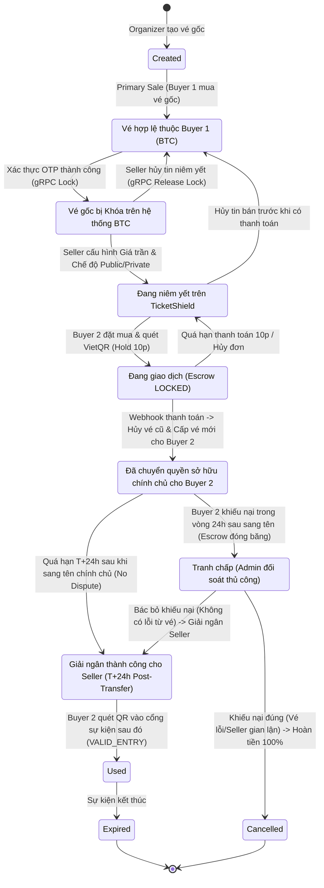
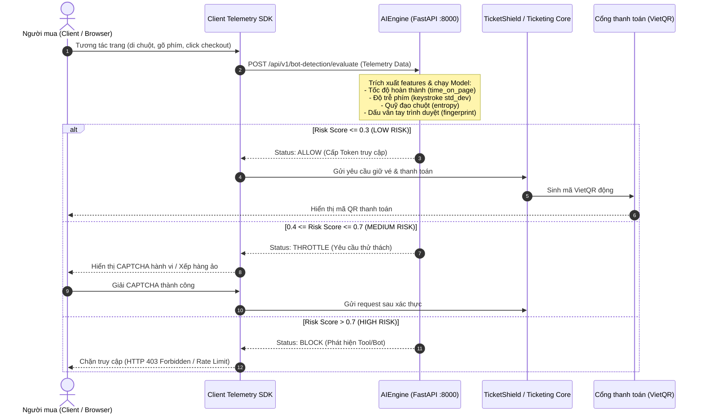
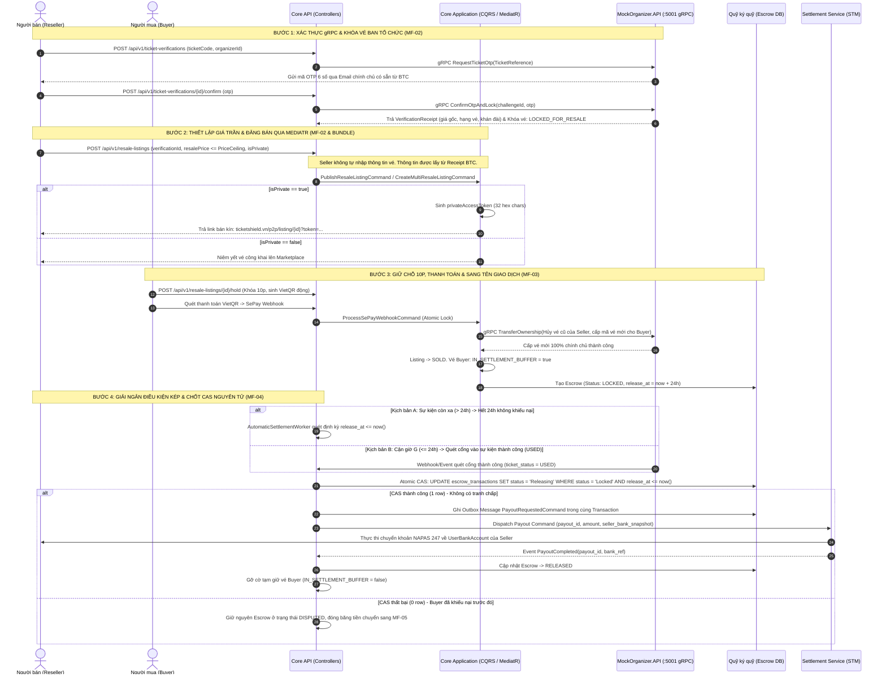
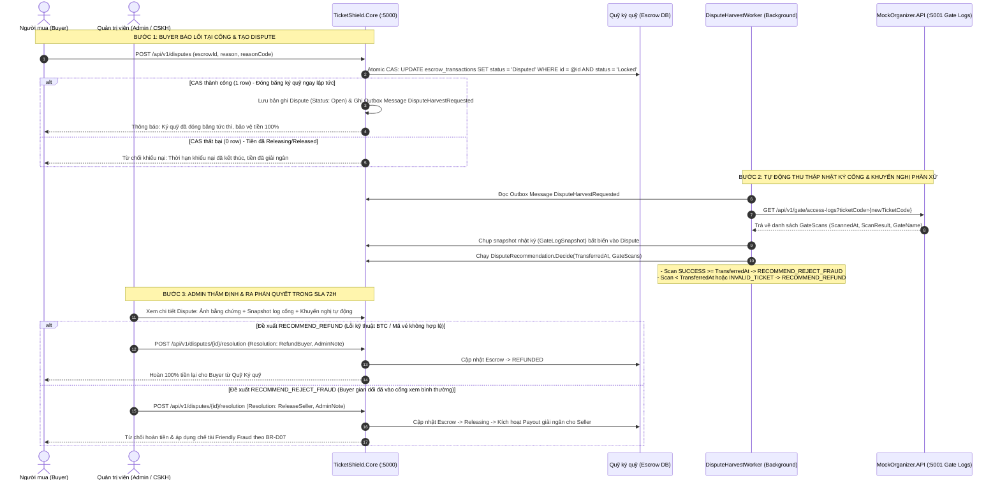
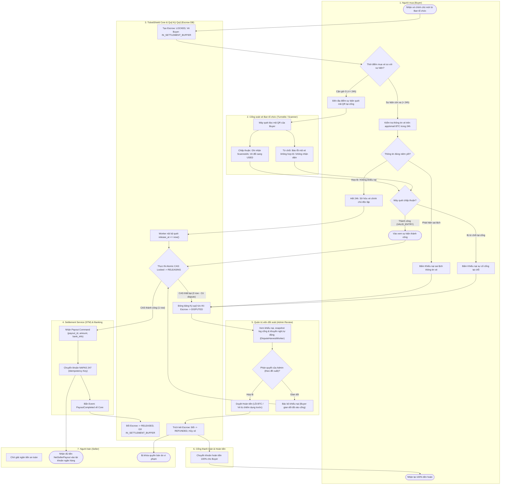

# TicketShield AI - 5 Mental Model Diagrams

Tài liệu thể hiện **5 sơ đồ bắt buộc** theo chuẩn Checklist nghiên cứu FA26SE261 bằng cú pháp Mermaid trực quan, phản ánh chính xác quy tắc nghiệp vụ và kiến trúc 3 services của dự án.

---

## Sơ đồ 1: Vòng Đời Của Vé (Ticket Lifecycle State Machine)

Mô tả toàn bộ các trạng thái mà một chiếc vé trải qua từ lúc Ban tổ chức phát hành, khóa niêm yết bán lại, chuyển giao và giải ngân:



---

## Sơ đồ 2: Luồng Mua Sơ Cấp & Phát Hiện Bot AI (Primary Purchase Flow & AI Bot Detection)

Minh họa cơ chế thu thập sinh trắc học hành vi client và đánh giá rủi ro (Risk Scoring) phân loại 3 mức Allow / Throttle / Block:



---

## Sơ đồ 3: Luồng Chuyển Nhượng P2P & Ký Quỹ Escrow (P2P Resale & Escrow Flow)

Thể hiện quy trình: **gRPC Verification -> Configurable Markup -> Dual-Hold (Tiền & Vé) -> Transfer Ownership -> Dual-Condition Payout**:



---

## Sơ đồ 4: Luồng Đối Soát Tranh Chấp & Thu Thập Log Cổng Tự Động (Dispute & Evidence Harvest Flow)

Quy trình xử lý sự cố tại cổng sự kiện: Hệ thống tự động thu thập nhật ký soát vé từ Ban tổ chức qua `DisputeHarvestWorker` và đưa ra khuyến nghị phân xử khách quan hỗ trợ Admin:



---

## Sơ đồ 5: Kiến Trúc Hệ Thống Tổng Thể (System Architecture & Topology)

Minh họa 3 services độc lập, các cơ sở dữ liệu riêng biệt và tích hợp ngoại vi:

```mermaid
flowchart TB
    subgraph ClientLayer ["Lớp Khách Hàng (Client Layer)"]
        WebUI["TicketShield Web App (Next.js / Vanilla TS)"]
        MobileSDK["Client Telemetry SDK (Mouse / Keystroke / Fingerprint)"]
    end

    subgraph CoreService ["TicketShield.Core (.NET 8 Web API :5000)"]
        API_GW["API Gateway (YARP) / Controllers"]
        subgraph CleanArch ["Clean Architecture & CQRS"]
            AppCQRS["Application (MediatR Commands/Queries / FluentValidation)"]
            DomainLogic["Domain (Entities / Value Objects / Price Ceiling Laws)"]
            InfraPersist["Infrastructure (EF Core / Advisory Locks / Polly)"]
        end
        subgraph Workers ["Background Workers"]
            AutoSettleWorker["AutomaticSettlementWorker (T+24h & Gate Entry)"]
            HoldWorker["ExpiredHoldReleaseWorker (10m Hold Release)"]
            DisputeWorker["DisputeHarvestWorker (Gate Log Snapshot & Recommendation)"]
            StuckWorker["StuckSettlementWorker (Payout Recovery)"]
        end
    end

    subgraph AIService ["AIEngine Service (Python FastAPI :8000)"]
        FastAPI_App["FastAPI Server (:8000)"]
        ML_Model["ML Inference Engine (Random Forest / XGBoost)"]
    end

    subgraph MockOrganizerService ["MockOrganizer.API (.NET 8 Web API :5001 / :5002)"]
        OrgGrpc["gRPC OrganizerResaleService (organizer_resale.proto)"]
        OrgControllers["Organizer Gate API (gate_access_logs)"]
        TicketLifecycleMgr["Ticket Issue / Cancel / Transfer Engine"]
        GateSimulator["Gate Access & Scanner Simulator"]
    end

    subgraph DataStorage ["Lớp Dữ Liệu & Hạ Tầng (PostgreSQL Cluster)"]
        CoreDB[("ticketshield_db<br/>- resale_listings<br/>- core_resale_records (bundles)<br/>- escrow_transactions<br/>- disputes<br/>- outbox_messages")]
        OrgDB[("organizer_db<br/>- mock_tickets<br/>- organizer_resale_records<br/>- gate_access_logs")]
    end

    subgraph ExternalIntegrations ["Dịch Vụ Tích Hợp Ngoại Vi"]
        VietQR["Cổng Thanh Toán VietQR / SePay Webhook"]
        SMTP["Hệ Thống Gửi Email OTP (SMTP Server)"]
    end

    %% Interactions
    WebUI -->|REST API / JWT| API_GW
    MobileSDK -->|Telemetry Payload| FastAPI_App
    FastAPI_App --> ML_Model
    ML_Model -->|Risk Score & Outcome| API_GW

    API_GW --> AppCQRS
    AppCQRS --> DomainLogic
    AppCQRS --> InfraPersist
    InfraPersist -->|Npgsql / EF Core| CoreDB
    Workers --> CoreDB

    InfraPersist -->|gRPC (:5002)| OrgGrpc
    DisputeWorker -->|HTTP GET /gate/access-logs| OrgControllers
    OrgGrpc --> TicketLifecycleMgr
    OrgControllers --> GateSimulator
    TicketLifecycleMgr -->|Npgsql| OrgDB
    GateSimulator -->|Log Scans| OrgDB

    InfraPersist -->|Generate Dynamic VietQR| VietQR
    OrgGrpc -->|Send OTP Code| SMTP
```

---

## Sơ đồ 6: Luồng Giải Ngân Điều Kiện Kép & Xử Lý Sự Cố (Settlement Worker Swimlane)

Mô tả chi tiết sự phối hợp giữa 7 làn vai trò (Swimlanes) theo 2 kịch bản thời gian (Kịch bản A: Sự kiện còn xa > 24h; Kịch bản B: Giao dịch cận giờ G <= 24h) và nhánh xử lý khiếu nại đối soát:



